<div align="center">

# VXH Overlays

**Free animated overlays for OBS and Streamlabs with an in-browser configurator.** Tweak the look on a live preview, copy one link and paste it into a Browser Source.

[](https://overlays.vxh.pl/)
[](./LICENSE)

[Open the studio](https://overlays.vxh.pl/) · [Adding to OBS (PL)](https://overlays.vxh.pl/en/docs/obs) · [FAQ (PL)](https://overlays.vxh.pl/en/docs/faq) · [Polski](./README.md)

</div>

<p align="center">
  <a href="https://overlays.vxh.pl/">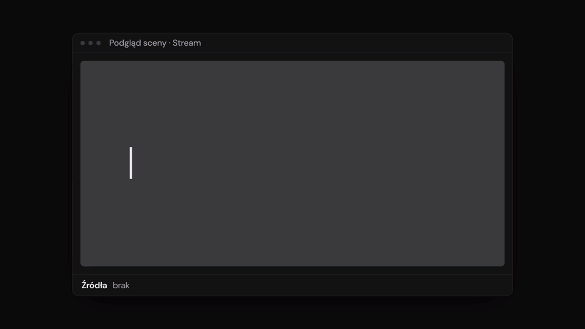</a><br>
  <sub>The studio in 20 seconds · <a href="docs/media/brag.mp4">MP4 version with sound</a></sub>
</p>

## Gallery

| Starting soon | Be right back | Stream ending |
|---|---|---|
| 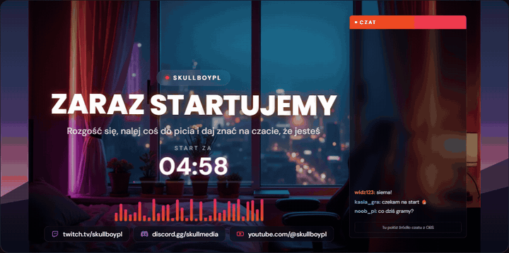 | 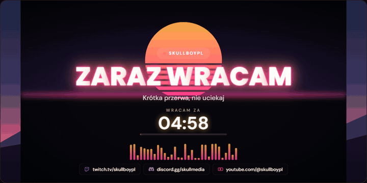 | 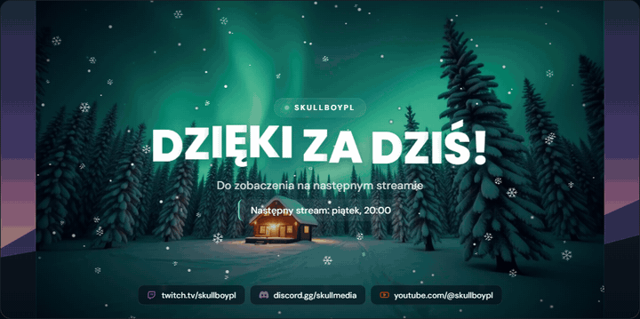 |

| Christmas | Halloween | Fireworks |
|---|---|---|
| 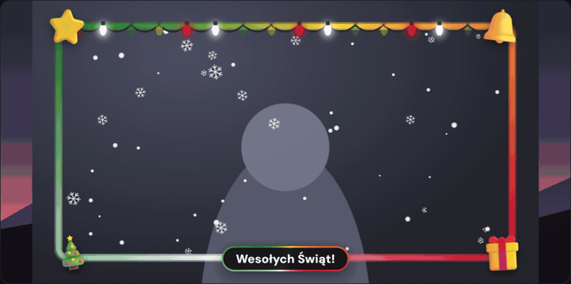 | 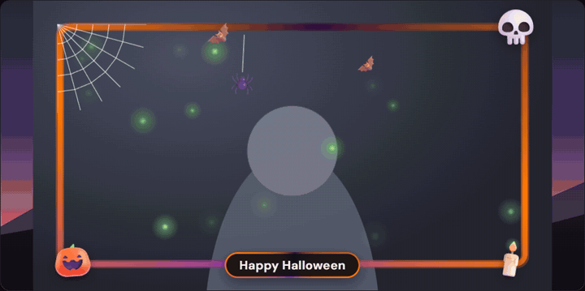 | 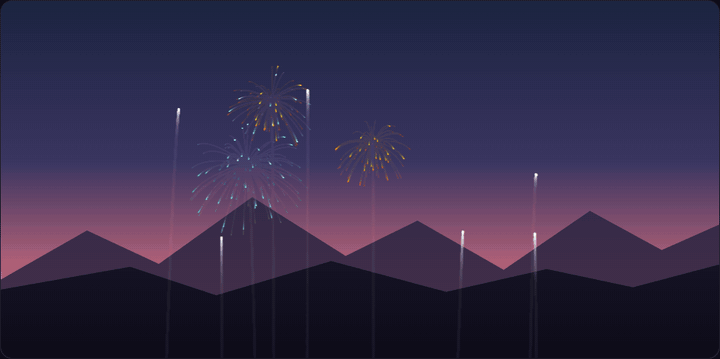 |

| Snow | Confetti | Socials rotator |
|---|---|---|
| 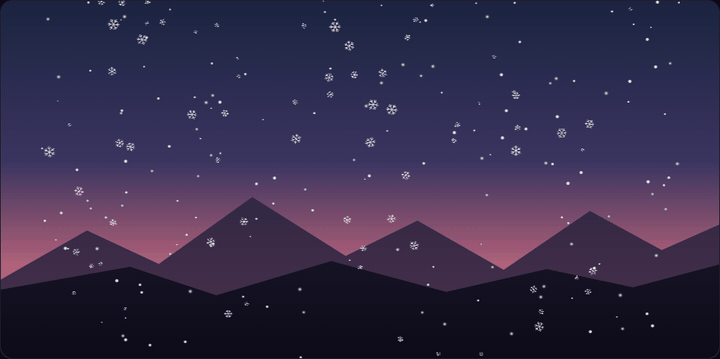 | 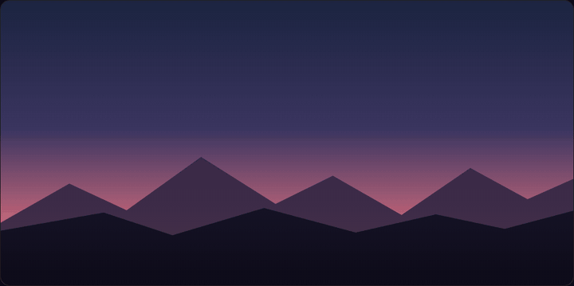 | 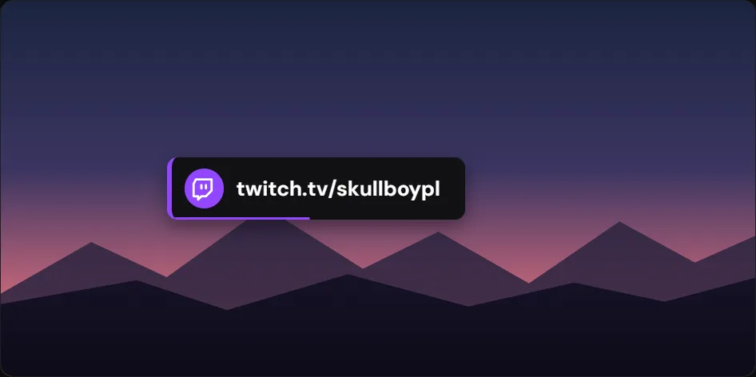 |

<p align="center">
  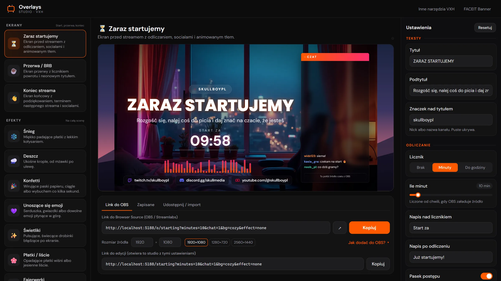<br>
  <sub>Studio: overlay list, live preview, grouped settings and the OBS link</sub>
</p>

| Background picker (19) | Phone | Phone menu |
|---|---|---|
| 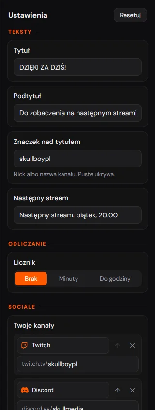 | 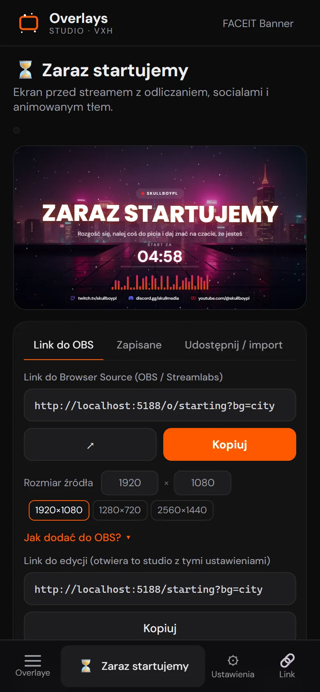 | 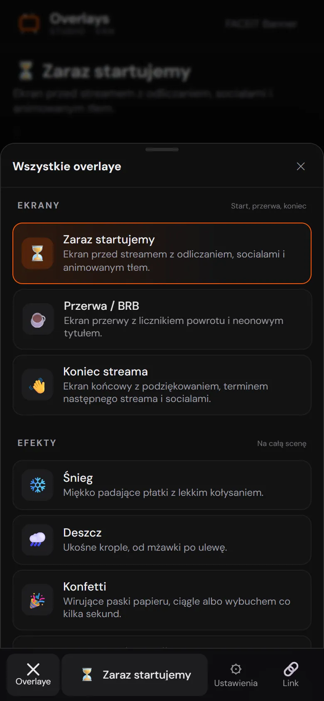 |

---

## What it is

A studio with a list of overlays, a live preview and a settings panel. Every overlay is a plain web page with a transparent background, and all settings live in the link. No account, no plugins, no watermark and no backend: it is a static site served by nginx.

Part of the [VXH](https://vxh.pl/) toolset for streamers (next to [FACEIT Banner Studio](https://faceitbanner.vxh.pl/)). The interface and docs come in 10 languages: Polish, English, German, Czech, Spanish, French, Portuguese, Russian, Turkish and Ukrainian. The docs (wiki) live under `/docs`.

## Overlays

### 🎬 Screens (scene, 1920x1080)

| ID | Name (PL) | What it does |
|---|---|---|
| `starting` | Zaraz startujemy | Starting soon screen with countdown, socials and animated background |
| `brb` | Przerwa / BRB | Break screen with a "back in" timer and a neon title |
| `ending` | Koniec streama | Thank-you screen with the next stream date and socials |

Shared screen options: title, subtitle and a kicker above the title; timer (off, minutes counted from when OBS loads the source, or until a given HH:MM) with a "done" text and a progress bar; socials bar with icons; chat slot (left/right, width, style: glass, outline or transparent cutout); background: 9 animated CSS ones (aurora, synthwave, waves, space, minimal, gradient, rays, dots, lava), 10 images (night room, neon city, winter forest, Christmas, Halloween, nebula, anime sunset, 3D abstract, sakura, beach) with slow zoom/pan, dimming and tint, or your own image URL, up to 3 colors, base and text color; title animation (rise, wave, pop, neon, glitch) and 6 fonts; an effect on top (stars, warp, snow, fireflies, confetti, petals, emoji, fireworks), animated equalizer and vignette.

> The background images in `public/bg/` were generated locally with FLUX.1-dev in ComfyUI for this project.

### ✨ Effects (full screen, 1920x1080)

| ID | Name (PL) | Main options |
|---|---|---|
| `snow` | Śnieg (snow) | amount, speed, size, wind, color, depth blur, dots / crystals / mixed, area |
| `rain` | Deszcz (rain) | amount, speed, wind, color, splashes at the bottom, area |
| `confetti` | Konfetti | up to 6 colors, continuous rain or a burst from the bottom every N seconds |
| `emoji` | Unoszące się emoji (floating emoji) | your own emoji (picked at random), up or down, area |
| `fireflies` | Świetliki (fireflies) | color, glow strength, area |
| `petals` | Płatki / liście (petals / leaves) | up to 5 colors, petal or leaf shape |
| `fireworks` | Fajerwerki (fireworks) | rockets per volley, volley interval, colors, burst shape (mixed, ring, heart), twinkle |
| `stars` | Gwiazdy / warp | twinkling sky with shooting stars, or a hyperspace warp |
| `fog` | Mgła (fog) | banks near the ground, at the top or everywhere; wind, colour |
| `dust` | Pyłki w świetle (dust motes) | twinkling specks in a light beam, glow, area |
| `lightning` | Błyskawice (lightning) | branching bolts or just the flash every N seconds, flash strength, colours |
| `glitch` | Glitch ekranu (screen glitch) | RGB tears, noise blocks, scanlines; subtle mode |
| `grain` | Ziarno + winieta (grain + vignette) | film grain, vignette, VHS scanlines, flicker |

`area` is the full screen, left or right half, or the edges only.

### 📷 Camera (640x360)

| ID | Name (PL) | Main options |
|---|---|---|
| `neon` | Neonowa ramka (neon frame) | rotating gradient of up to 5 colors, thickness, radius, glow, speed |
| `corners` | Narożniki HUD (HUD corners) | crosshair corners, scan line, REC dot, breathing |
| `nametag` | Ramka z podpisem (name tag) | frame with a bar for a nick and caption, 5 bar positions, periodic shine |
| `glitchframe` | Ramka glitch (glitch frame) | split RGB channels, tears, crosshair corners, label and a changing HEX code |
| `retroframe` | Ramka CRT / VHS | TV, VHS tape or camcorder; scanlines, PLAY, timecode, REC, tracking noise |
| `polaroid` | Ramka polaroid | paper border, handwritten caption, tape or pin, tilt and sway |
| `pixelframe` | Ramka 8-bit (pixel frame) | pixel border with a HUD: hearts, score, coins, blinking text |
| `holiday` | Ramki świąteczne (holiday frames) | 8 themes: Christmas, Winter, New Year's Eve, Valentine's, Easter, Halloween, Polish Independence Day (Nov 11), Birthday; corner decorations, garland, inner effect; each in 5 versions: animated, realistic (AI), 3D, cartoon, neon; label with size and position |

### 📰 Bars and text

| ID | Name (PL) | Size | Main options |
|---|---|---|---|
| `ticker` | Przewijany pasek (ticker) | 1920x64 | list of messages, label, separator, style, speed in px/s, font |
| `social` | Pojedynczy social (single social) | 520×110 | one channel with a call to action, 18 looks, 13 enter and 8 loop animations |
| `lowerthird` | Belka z nazwiskiem (lower third) | 900×160 | name, caption, brand icon; 8 looks, 8 enter animations (glitch included), show-every-N-seconds mode |
| `schedule` | Harmonogram (schedule) | 1200×120 | days and times in a row, column or grid; today highlights itself |
| `qrrotator` | Rotator kodów QR (QR rotator) | 320×400 | several links in turn; transitions: glitch, flip, 3D cube, pixelate and more |
| `socials` | Rotator sociali (socials rotator) | 560x100 | Twitch, Kick, YouTube, TikTok, Discord, Instagram, X, Facebook or custom text; switch every N seconds, 3 animations, brand colors, timer bar |

The full parameter list of every overlay (keys, ranges, defaults) is generated at build time into [`/llms.txt`](https://overlays.vxh.pl/llms.txt).

## Using it in OBS

1. Open [overlays.vxh.pl](https://overlays.vxh.pl/), pick an overlay and set it up on the preview.
2. Click **Kopiuj** (Copy) next to the Browser Source link.
3. In OBS: **Sources -> + -> Browser**, paste the link into the URL field.
4. Set the source size shown under the preview: 1920x1080 for screens and effects, 640x360 for camera frames, 1920x64 for the ticker, 560x100 for the socials rotator. The studio also offers other sizes (for example 1280x720, 2560x1440, 400x400).
5. Put effects and frames above the game and camera. Add the start, break and end screens as separate scenes and place your chat on the reserved slot.

It works the same in Streamlabs Desktop and other apps with a Browser Source. After changing settings, copy the new link and replace it in the source properties.

## Link format

| Path | What it shows |
|---|---|
| `/` | studio (first overlay in the list) |
| `/<id>?...` | studio with that overlay and the settings from the link (edit link) |
| `/o/<id>?...` | the bare overlay for OBS, transparent background |
| `/jak-dodac-overlay-do-obs`, `/faq` | guide and FAQ |

Parameter rules (`src/overlays/schema.ts`):

- Only settings that differ from the default go into the link. A missing parameter means the default value.
- Colors are hex **without `#`**: `color=ff5900`. Several colors are comma separated: `colors=ff5900,ffd23f`.
- Toggles are `1` / `0`.
- Numbers are clamped to the slider range; unknown select values and invalid colors are ignored.
- Text lists (messages, socials) are separated by ` | `.

Example: a starting screen with a 10 minute countdown, synthwave background and chat on the right:

```
https://overlays.vxh.pl/o/starting?minutes=10&bg=synth&chat=1
```

## Saved presets and share codes

- The studio remembers the last settings of each overlay, and the **Zapisane** (Saved) tab stores named presets. All of it lives **only in this browser's `localStorage`**; nothing is sent to a server. Another computer, another browser, incognito mode or clearing site data means no presets.
- To move a setup, use a **share code** `VXH1-...`: the overlay id and its link query (optionally a name), base64url encoded. There is also a single code with the whole preset list.
- The **Udostępnij / import** (Share / import) tab accepts a `VXH1-` code, a list code, an OBS link (`/o/...`) or an edit link (`/<id>?...`).

## Local development

Requirements: Node 22+, pnpm 10 (`corepack enable` picks the version from `package.json`).

```bash
git clone https://github.com/skullboypl/Overlays-VXH.git
cd Overlays-VXH
pnpm install
pnpm dev       # http://localhost:5173 (also listens on your LAN)
pnpm build     # tsc --noEmit, vite build, prerender
pnpm preview   # serve the built dist/
```

After the Vite build, `pnpm build` runs `pnpm prerender`: it builds `src/seo/prerender.tsx` in SSR mode into `.ssr/` and writes into `dist/`:

- static HTML for every page (`/`, `/<id>` for each overlay, guide, FAQ) with meta tags, JSON-LD and a readable article,
- `app.html`, a bare app shell for `/o/...` (no article, so nothing flashes in OBS),
- `sitemap.xml`, `robots.txt` (with `Disallow: /o/`) and `llms.txt`.

## Project structure

```
src/
  main.tsx              routing: studio, /o/:id, guide, FAQ
  overlays/
    registry.ts         overlay list: id, category, size, configurator fields
    schema.ts           field types, defaults, link <-> settings
    Overlay.tsx         picks the renderer by id
    particles.ts        canvas engine for snow, rain, confetti, emoji, fireflies, petals
    sky.ts              fireworks and stars / warp
    ParticleLayer.tsx   canvas + effect restart when settings change
    SceneScreen.tsx     start, break and end screens
    HolidayFrame.tsx    holiday frames
    frames.tsx          neon, HUD corners, name tag
    GrainLayer.tsx      grain and vignette
    widgets.tsx         ticker and socials rotator
    icons.tsx           service icons and colors
    *.css               overlay styles
  studio/
    Studio.tsx          list, preview, settings
    Fields.tsx          field controls
    ListEditors.tsx     list editors (messages, socials)
    OutputPanel.tsx     OBS link, saved presets, share / import
    presets.ts          localStorage and VXH1- codes
    SeoSection.tsx      copy under the studio, guide / FAQ pages
  seo/
    content.ts          page copy, FAQ, keywords
    SeoArticle.tsx      article rendered in the studio and in the prerender
    prerender.tsx       static HTML, sitemap.xml, robots.txt, llms.txt
deploy/nginx.conf       nginx config used in the Docker image
Dockerfile              build (node 22 + pnpm) -> nginx
captain-definition      CapRover
```

## Adding a new overlay

1. Add an entry to `OVERLAYS` in [`src/overlays/registry.ts`](src/overlays/registry.ts): `id` (also the `/<id>` and `/o/<id>` path), `name`, `icon`, `category` (`scene`, `screen`, `camera` or `widget`), `size` (suggested source size), `description` and `fields`.
   Field types (`src/overlays/schema.ts`): `range`, `color`, `colors`, `toggle`, `select`, `text` (with `list: 'lines' | 'socials'` for lists). Optional `group` (section heading) and `when` (show the field only for a given value of another field). The settings panel, the link and `llms.txt` are derived from these fields automatically.
2. Write the renderer and wire it up in [`src/overlays/Overlay.tsx`](src/overlays/Overlay.tsx). It receives `params` with the field values. A particle effect can instead be added to the engine in `particles.ts` (`ParticleKind`) and to `EFFECT_KINDS` in `ParticleLayer.tsx`.
3. Optionally add SEO copy to `COPY` in [`src/seo/content.ts`](src/seo/content.ts). Without it the page uses the title and description from the registry.
4. Run `pnpm build`: the `/<id>` page shows up in `dist/` and in `sitemap.xml`.

An overlay needs a transparent background (except screens, which have their own) and should look the same in the preview and in OBS: size things relative to the source, not the studio window.

## Deploy

The [`Dockerfile`](Dockerfile) builds on `node:22-alpine` with pnpm 10.33.0, then copies `dist/` into `nginx:1.27-alpine` with [`deploy/nginx.conf`](deploy/nginx.conf):

- `/o/...` always gets `app.html` (no prerendered article),
- other paths: the file, then `<path>/index.html`, then `index.html` (SPA fallback),
- `/assets/` cached for a year, everything else `no-cache`, gzip and basic security headers.

```bash
docker build -t vxh-overlays .
docker run --rm -p 8080:80 vxh-overlays   # http://localhost:8080
```

CapRover: [`captain-definition`](captain-definition) points at the `Dockerfile`, so deploying the repository as an app is enough. Production runs at `overlays.vxh.pl`. If you host your own copy on another domain, change `SITE.url` in `src/seo/content.ts` and the URLs in `index.html`.

Deploying from GitHub over SSH: in CapRover open **Deployment → Method 3: Deploy from Github/Bitbucket/Gitlab**, set the repo `git@github.com:skullboypl/Overlays-VXH.git`, branch `main` and the private key. Add the matching public key in GitHub under **Settings → Deploy keys** (read-only). Key files (`deploy-key*`, `*.pem`, `*.key`) are in `.gitignore` and `.dockerignore`: never commit them or paste them anywhere public. The app needs no environment variables.

## Contributing

Bug reports and new overlay ideas: [Issues](https://github.com/skullboypl/Overlays-VXH/issues). Rules and the local check before a PR: [CONTRIBUTING.md](./CONTRIBUTING.md). Security issues: [SECURITY.md](./SECURITY.md).

## License

[MIT](./LICENSE) © 2026 [skullboypl](https://github.com/skullboypl)

<div align="center">

Made by [skullboypl](https://github.com/skullboypl) · [Twitch](https://www.twitch.tv/skullboypl) · [vxh.pl](https://vxh.pl/)

</div>
