<div align="center">

# VXH Overlays

**Darmowe animowane overlaye do OBS i Streamlabs z konfiguratorem w przeglądarce.** Ustawiasz wygląd na podglądzie, kopiujesz jeden link i wklejasz go jako źródło Browser Source.

[](https://overlays.vxh.pl/)
[](./LICENSE)

[Otwórz studio](https://overlays.vxh.pl/) · [Jak dodać do OBS](https://overlays.vxh.pl/docs/obs) · [FAQ](https://overlays.vxh.pl/docs/faq) · [English](./README.en.md)

</div>

<p align="center">
  <a href="https://overlays.vxh.pl/">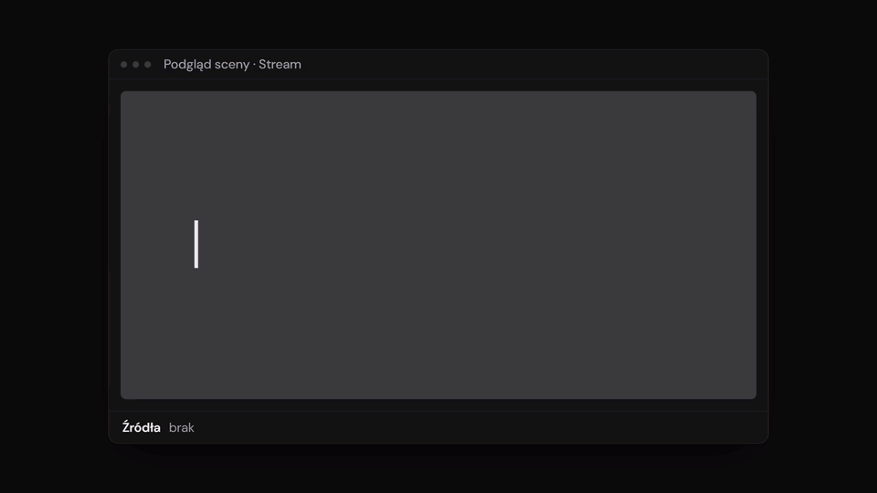</a><br>
  <sub>20 sekund o studiu · <a href="docs/media/brag.mp4">wersja MP4 z dźwiękiem</a></sub>
</p>

## Galeria

| Zaraz startujemy | Przerwa / BRB | Koniec streama |
|---|---|---|
| 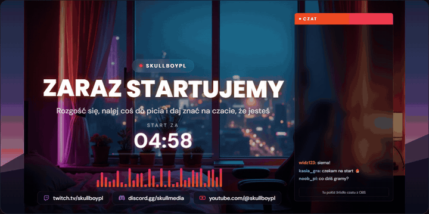 | 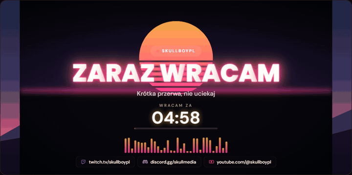 | 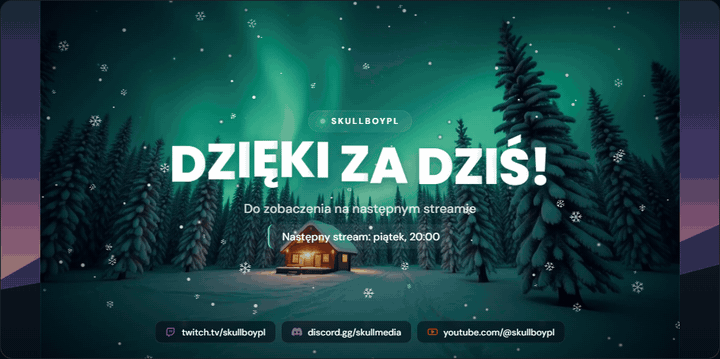 |

| Boże Narodzenie | Halloween | Fajerwerki |
|---|---|---|
| 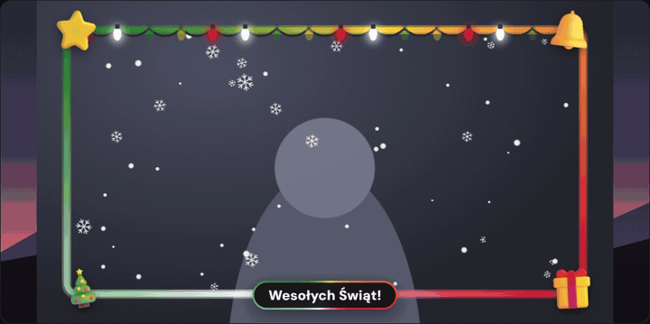 | 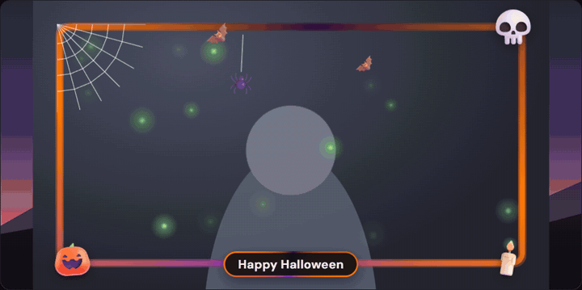 | 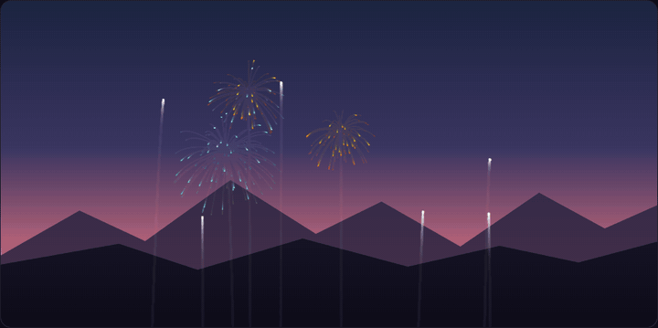 |

| Śnieg | Konfetti | Rotator sociali |
|---|---|---|
| 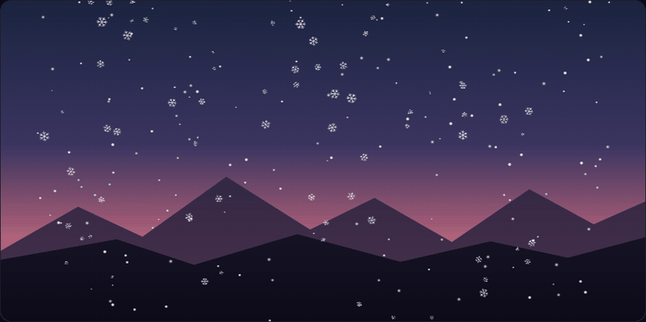 | 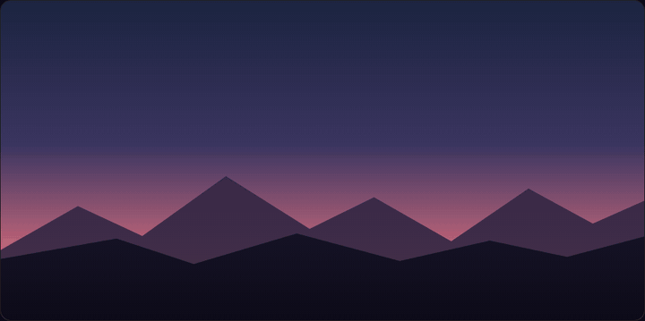 | 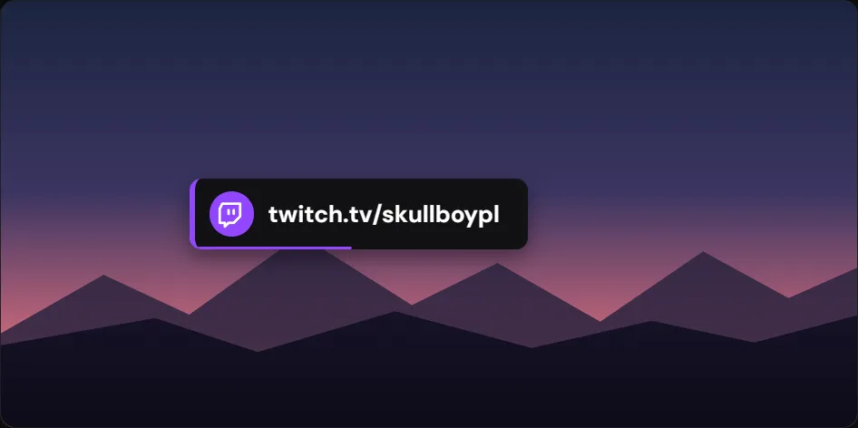 |

<p align="center">
  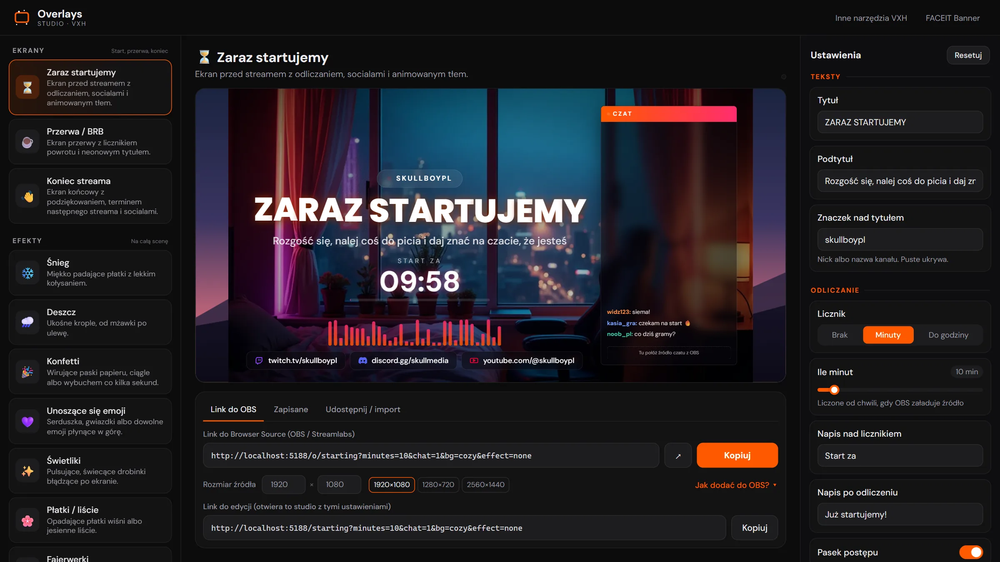<br>
  <sub>Studio: lista overlayów, podgląd na żywo, ustawienia w sekcjach i link do OBS</sub>
</p>

| Wybór tła (19 teł) | Telefon | Menu na telefonie |
|---|---|---|
| 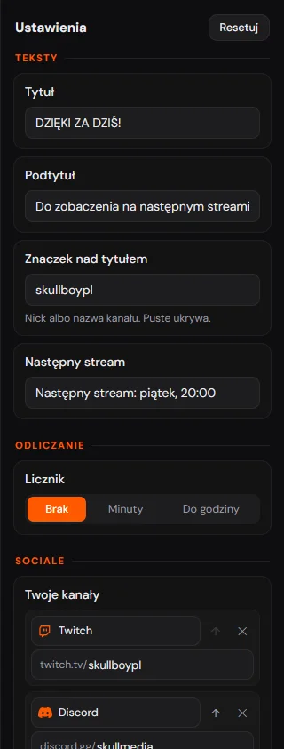 | 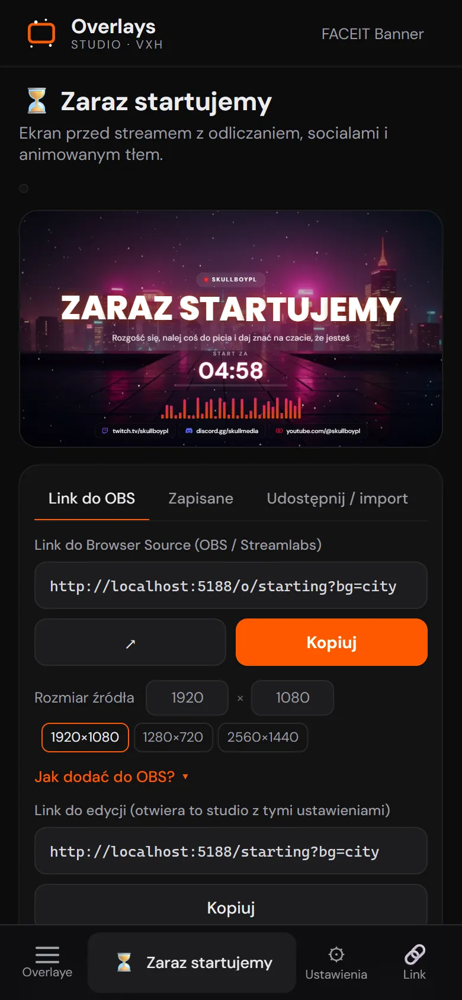 | 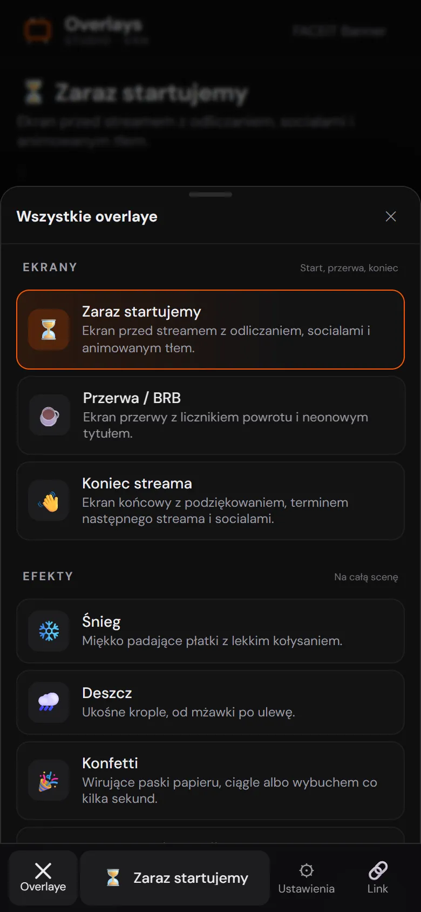 |

---

## Co to jest

Studio z listą overlayów, podglądem na żywo i panelem ustawień. Każdy overlay to zwykła strona z przezroczystym tłem, a wszystkie ustawienia siedzą w linku. Bez konta, bez wtyczek, bez znaku wodnego i bez backendu: to statyczna strona serwowana przez nginx.

Część zestawu narzędzi [VXH](https://vxh.pl/) dla streamerów (obok [FACEIT Banner Studio](https://faceitbanner.vxh.pl/)). Interfejs i dokumentacja są w 10 językach: polskim, angielskim, niemieckim, czeskim, hiszpańskim, francuskim, portugalskim, rosyjskim, tureckim i ukraińskim. Dokumentacja (wiki) jest pod `/docs`.

## Overlaye

### 🎬 Ekrany (scena 1920×1080)

| ID | Nazwa | Co robi |
|---|---|---|
| `starting` | Zaraz startujemy | Ekran przed streamem z odliczaniem, socialami i animowanym tłem |
| `brb` | Przerwa / BRB | Ekran przerwy z licznikiem powrotu i neonowym tytułem |
| `ending` | Koniec streama | Podziękowanie, termin następnego streama i sociale |
| `videobg` | Tło wideo | Zapętlone realistyczne wideo na całą scenę (miasto neon, pokój nocą, zimowy las, święta) z rozmyciem, przyciemnieniem, efektem i ziarnem |

Wspólne opcje ekranów: 10 układów (środek, lewo, prawo, pasek dolny, góra, tytuł i licznik obok, karta, baner, wielki licznik, róg); tytuł, podtytuł (jeden albo kilka zmienianych co N sekund) i znaczek nad tytułem; licznik (brak, minuty od załadowania źródła w OBS albo do podanej godziny HH:MM) z napisem po odliczeniu i paskiem postępu; pasek sociali z ikonami; miejsce na czat (7 miejsc, szerokość, wygląd: szkło, obramowanie albo przezroczysta dziura); tło: 9 animowanych w CSS (zorza, synthwave, fale, kosmos, minimal, gradient, promienie, kropki, lava), 10 obrazków (pokój nocą, miasto neon, zimowy las, święta, Halloween, mgławica, zachód anime, abstrakcja 3D, sakura, plaża) z powolnym zoomem/przesuwem, 4 wideo albo własny obrazek z linku, przyciemnienie i zabarwienie, do 3 kolorów, kolor bazowy i tekstu; animacja tytułu (wjazd, fala, pop, neon, glitch) i 10 czcionek; jeden z 15 efektów na wierzchu, animowany equalizer i winieta.

> Obrazki teł w `public/bg/` zostały wygenerowane lokalnie modelem FLUX.1-dev w ComfyUI na potrzeby tego projektu.

### 🎥 Sceny z kamerką (1920×1080)

| ID | Nazwa | Najważniejsze opcje |
|---|---|---|
| `camscene` | Kamerka fullscreen | 12 układów z miejscem na kamerkę, grę i czat (m.in. duo, squad, pionowy, kinowy), ramki slotów (gradient, pełne, świecące, szkło) z 4 animacjami, tło i efekt, tytuł z kropką LIVE, zegarem i czasem streamu, podpis na kamerce w 4 stylach, sociale, oprawa świąteczna, staty FACEIT |
| `fullcam` | Pełnoekranowa kamera | warstwa nad kamerą na cały ekran: wszystkie opcje Ramki Pro, tytuł z zegarem, nick, sociale, oprawa świąteczna, staty FACEIT, efekt i winieta |

### ✨ Efekty (cały ekran 1920×1080)

| ID | Nazwa | Najważniejsze opcje |
|---|---|---|
| `snow` | Śnieg | ilość, prędkość, rozmiar, wiatr, kolor, rozmycie głębi, kropki / kryształki / mieszane, obszar |
| `rain` | Deszcz | ilość, prędkość, wiatr, kolor, rozbryzgi na dole, obszar |
| `confetti` | Konfetti | do 6 kolorów, ciągły deszcz albo wybuch z dołu co N sekund, obszar |
| `emoji` | Unoszące się emoji | własne emoji (losowane), kierunek w górę lub w dół, obszar |
| `fireflies` | Świetliki | kolor, siła poświaty, obszar |
| `petals` | Płatki / liście | do 5 kolorów, kształt płatek lub liść, obszar |
| `embers` | Iskry z ogniska | kolory, poświata, wiatr, obszar |
| `bubbles` | Bańki mydlane | kolory, wiatr, obszar |
| `bokeh` | Bokeh | rozmyte świetlne kręgi w wybranych kolorach |
| `sparkles` | Błyski brokatu | kolory, obszar (też tylko brzegi) |
| `balloons` | Balony | kolory, wiatr, obszar |
| `meteors` | Spadające gwiazdy | co ile sekund, kierunek, kolory |
| `digital` | Cyfrowy deszcz | kolory, obszar |
| `fireworks` | Fajerwerki | rakiet na salwę, odstęp salw, kolory, kształt wybuchu (mieszany, pierścień, serce), migotanie |
| `stars` | Gwiazdy / warp | migotanie ze spadającymi gwiazdami albo lot w hiperprzestrzeń |
| `grain` | Ziarno + winieta | ziarno filmowe, winieta, linie VHS, migotanie |

Obszar (`area`) to cały ekran, lewa lub prawa połowa albo tylko boki.

### 📷 Kamerka (640×360)

| ID | Nazwa | Najważniejsze opcje |
|---|---|---|
| `neon` | Neonowa ramka | obracający się gradient z do 5 kolorów, grubość, zaokrąglenie, poświata, prędkość |
| `corners` | Narożniki HUD | narożniki celownika, linia skanu, kropka REC, oddychanie |
| `nametag` | Ramka z podpisem | ramka z paskiem na nick i podpis, 5 pozycji paska, błysk co kilka sekund |
| `holiday` | Ramki świąteczne | 8 okazji: Boże Narodzenie, Zima, Sylwester, Walentynki, Wielkanoc, Halloween, 11 Listopada, Urodziny, albo „automatycznie wg daty”; do 13 wersji każdej (animowana, 5 realistycznych, 3D, kreskówka, do 5 neonów); dekoracje w rogach, girlanda, efekt w środku, napis z wyborem wielkości i pozycji |
| `proframe` | Ramka Pro | 4 kształty, 6 rodzajów obramowania, 4 animacje, akcenty w rogach, maska poza kamerką |
| `faceitcam` | Kamerka + FACEIT | Ramka Pro ze statami FACEIT (level, ELO, K/D, forma, zmiana ELO na streamie; 6 wyglądów) albo banerem z FACEIT Banner |

### 🎅 Postacie (1920×1080)

| ID | Nazwa | Najważniejsze opcje |
|---|---|---|
| `character` | Animowane postacie | Mikołaj, elf, renifer, bałwan, dynia, wiedźma, zajączek, amorek i inne w pętli z przezroczystym tłem; pozycja, rozmiar, odbicie, cień, pętla albo pojawianie się co N sekund |

### 📰 Paski i napisy

| ID | Nazwa | Rozmiar | Najważniejsze opcje |
|---|---|---|---|
| `ticker` | Przewijany pasek | 1920×64 | lista komunikatów przewijana albo zmieniana (4 animacje), etykieta, kropka LIVE, zegar, 7 stylów, czcionka |
| `socials` | Rotator sociali | 560×100 | 20 serwisów (m.in. Twitch, Kick, YouTube, TikTok, Discord, Instagram, X, Bluesky, Threads, Spotify, Steam, Patreon, Ko-fi, Tipply, Patronite) albo własny tekst; 6 układów, 18 stylów, 7 animacji, kolory serwisów, pasek czasu |

Czcionki (wspólne dla wszystkich overlayów): Poppins, Bebas, Russo, Orbitron, Pacifico, DM Sans, Montserrat, Rajdhani, Marker i Pixel.

Pełna lista parametrów każdego overlaya (klucze, zakresy, wartości domyślne) jest generowana przy buildzie do [`/llms.txt`](https://overlays.vxh.pl/llms.txt).

## Jak użyć w OBS

1. Otwórz [overlays.vxh.pl](https://overlays.vxh.pl/), wybierz overlay i ustaw go na podglądzie.
2. Kliknij **Kopiuj** przy „Link do Browser Source”.
3. W OBS: **Źródła → + → Przeglądarka** (Browser Source), wklej link w pole URL.
4. Ustaw rozmiar źródła podany pod podglądem: 1920×1080 dla ekranów i efektów, 640×360 dla ramek na kamerkę, 1920×64 dla paska, 560×100 dla rotatora sociali. Studio podpowiada też inne rozmiary (np. 1280×720, 2560×1440, 400×400).
5. Efekty i ramki połóż nad grą i kamerką. Ekrany startu, przerwy i końca dodaj jako osobne sceny, a czat połóż na zostawionej ramce.

Działa tak samo w Streamlabs Desktop i w innych programach z Browser Source. Po zmianie ustawień skopiuj nowy link i podmień go we właściwościach źródła.

## Format linku

| Adres | Co pokazuje |
|---|---|
| `/` | studio (pierwszy overlay z listy) |
| `/<id>?…` | studio z wybranym overlayem i ustawieniami z linku (link do edycji) |
| `/o/<id>?…` | sam overlay dla OBS, przezroczyste tło |
| `/jak-dodac-overlay-do-obs`, `/faq` | poradnik i FAQ |

Zasady parametrów (`src/overlays/schema.ts`):

- W linku są tylko ustawienia różne od domyślnych. Brakujący parametr = wartość domyślna.
- Kolory jako hex **bez `#`**: `color=ff5900`. Kilka kolorów po przecinku: `colors=ff5900,ffd23f`.
- Przełączniki jako `1` / `0`.
- Liczby są przycinane do zakresu suwaka, nieznane wartości list i błędne kolory są pomijane.
- Listy tekstowe (komunikaty, sociale) są rozdzielane ` | `.

Przykład: ekran startowy z 10-minutowym odliczaniem, tłem synthwave i czatem po prawej:

```
https://overlays.vxh.pl/o/starting?minutes=10&bg=synth&chat=1
```

## Zapisane ustawienia i kody udostępniania

- Studio pamięta ostatnie ustawienia każdego overlaya, a w zakładce **Zapisane** możesz zapisać je pod nazwą. Wszystko to jest **tylko w `localStorage` tej przeglądarki**, nic nie trafia na serwer. Inny komputer, inna przeglądarka, tryb incognito albo wyczyszczenie danych strony = brak zapisów.
- Do przenoszenia służą **kody udostępniania** `VXH1-…`: to id overlaya i jego parametry z linku (opcjonalnie nazwa) zakodowane w base64url. Jest też kod z całą listą zapisanych ustawień naraz.
- Import w zakładce **Udostępnij / import** przyjmuje kod `VXH1-`, kod z listą, link do OBS (`/o/…`) i link do edycji (`/<id>?…`).

## Uruchomienie lokalnie

Wymagania: Node 22+, pnpm 10 (`corepack enable` ustawi wersję z `package.json`).

```bash
git clone https://github.com/skullboypl/Overlays-VXH.git
cd Overlays-VXH
pnpm install
pnpm dev       # http://localhost:5173 (nasłuchuje też w sieci lokalnej)
pnpm build     # tsc --noEmit, vite build, prerender
pnpm preview   # podgląd zbudowanego dist/
```

`pnpm build` po buildzie Vite uruchamia `pnpm prerender`: buduje `src/seo/prerender.tsx` w trybie SSR do `.ssr/` i zapisuje do `dist/`:

- statyczny HTML dla każdej strony (`/`, `/<id>` dla każdego overlaya, poradnik, FAQ) z meta, JSON-LD i czytelnym artykułem,
- `app.html`, czystą powłokę aplikacji dla `/o/…` (bez artykułu, żeby OBS nic nie mignęło),
- `sitemap.xml`, `robots.txt` (z `Disallow: /o/`) i `llms.txt`.

## Struktura projektu

```
src/
  main.tsx              routing: studio, /o/:id, poradnik, FAQ
  overlays/
    registry.ts         lista overlayów: id, kategoria, rozmiar, pola konfiguratora
    schema.ts           typy pól, wartości domyślne, link <-> ustawienia
    Overlay.tsx         wybór renderera po id
    particles.ts        silnik canvas dla śniegu, deszczu, konfetti, emoji, świetlików, płatków
    sky.ts              fajerwerki i gwiazdy / warp
    ParticleLayer.tsx   canvas + restart efektu po zmianie ustawień
    SceneScreen.tsx     ekrany startu, przerwy i końca
    HolidayFrame.tsx    ramki świąteczne
    frames.tsx          neon, narożniki HUD, ramka z podpisem
    GrainLayer.tsx      ziarno i winieta
    widgets.tsx         przewijany pasek i rotator sociali
    icons.tsx           ikony i kolory serwisów
    *.css               style overlayów
  studio/
    Studio.tsx          lista, podgląd, ustawienia
    Fields.tsx          kontrolki pól
    ListEditors.tsx     edytory list (komunikaty, sociale)
    OutputPanel.tsx     link do OBS, zapisane, udostępnianie / import
    presets.ts          localStorage i kody VXH1-
    SeoSection.tsx      tekst pod studiem i strony poradnika / FAQ
  seo/
    content.ts          teksty stron, FAQ, słowa kluczowe
    SeoArticle.tsx      artykuł renderowany w studiu i w prerenderze
    prerender.tsx       statyczny HTML, sitemap.xml, robots.txt, llms.txt
deploy/nginx.conf       konfiguracja nginx w obrazie Dockera
Dockerfile              build (node 22 + pnpm) -> nginx
captain-definition      CapRover
```

## Jak dodać nowy overlay

1. Dodaj wpis do `OVERLAYS` w [`src/overlays/registry.ts`](src/overlays/registry.ts): `id` (to też adres `/<id>` i `/o/<id>`), `name`, `icon`, `category` (`scene`, `screen`, `camera` albo `widget`), `size` (sugerowany rozmiar źródła), `description` i `fields`.
   Typy pól (`src/overlays/schema.ts`): `range`, `color`, `colors`, `toggle`, `select`, `text` (z `list: 'lines' | 'socials'` dla list). Opcjonalnie `group` (nagłówek sekcji) i `when` (pokaż pole tylko przy danej wartości innego pola). Panel ustawień, link i `llms.txt` biorą się z tych pól automatycznie.
2. Dodaj renderer i podepnij go w [`src/overlays/Overlay.tsx`](src/overlays/Overlay.tsx). Renderer dostaje `params` z wartościami pól. Efekt cząsteczkowy możesz zamiast tego dopisać do silnika w `particles.ts` (typ `ParticleKind`) i do `EFFECT_KINDS` w `ParticleLayer.tsx`.
3. Opcjonalnie dopisz tekst SEO do `COPY` w [`src/seo/content.ts`](src/seo/content.ts). Bez wpisu strona dostanie tytuł i opis z rejestru.
4. Sprawdź `pnpm build`: strona `/<id>` pojawi się w `dist/` i w `sitemap.xml`.

Overlay musi mieć przezroczyste tło (poza ekranami, które mają własne) i wyglądać tak samo w podglądzie i w OBS: rozmiary licz względem wymiarów źródła, nie okna studia.

## Deploy

Obraz Dockera ([`Dockerfile`](Dockerfile)) buduje projekt na `node:22-alpine` z pnpm 10.33.0, a potem kopiuje `dist/` do `nginx:1.27-alpine` z [`deploy/nginx.conf`](deploy/nginx.conf):

- `/o/…` zawsze dostaje `app.html` (bez prerenderowanego artykułu),
- pozostałe adresy: plik, potem `<ścieżka>/index.html`, potem `index.html` (fallback SPA),
- `/assets/` z cache na rok, reszta `no-cache`, gzip i podstawowe nagłówki bezpieczeństwa.

```bash
docker build -t vxh-overlays .
docker run --rm -p 8080:80 vxh-overlays   # http://localhost:8080
```

CapRover: [`captain-definition`](captain-definition) wskazuje na `Dockerfile`, więc wystarczy wdrożyć repozytorium jako aplikację. Produkcja działa pod `overlays.vxh.pl`. Jeśli hostujesz własną kopię pod inną domeną, zmień `SITE.url` w `src/seo/content.ts` i adresy w `index.html`.

Deploy z GitHuba przez SSH: w CapRover w zakładce **Deployment → Method 3: Deploy from Github/Bitbucket/Gitlab** podaj repo `git@github.com:skullboypl/Overlays-VXH.git`, gałąź `main` i klucz prywatny. Ten sam klucz publiczny dodaj w GitHubie w **Settings → Deploy keys** (tylko do odczytu). Pliki kluczy (`deploy-key*`, `*.pem`, `*.key`) są w `.gitignore` i `.dockerignore`: nie commituj ich i nie wklejaj nigdzie publicznie. Aplikacja nie potrzebuje żadnych zmiennych środowiskowych.

## Współpraca

Zgłoszenia błędów i pomysły na nowe overlaye: [Issues](https://github.com/skullboypl/Overlays-VXH/issues). Zasady i lokalne sprawdzenie przed PR: [CONTRIBUTING.md](./CONTRIBUTING.md). Problemy z bezpieczeństwem: [SECURITY.md](./SECURITY.md).

## Licencja

[MIT](./LICENSE) © 2026 [skullboypl](https://github.com/skullboypl)

<div align="center">

Zrobione przez [skullboypl](https://github.com/skullboypl) · [Twitch](https://www.twitch.tv/skullboypl) · [vxh.pl](https://vxh.pl/)

</div>
